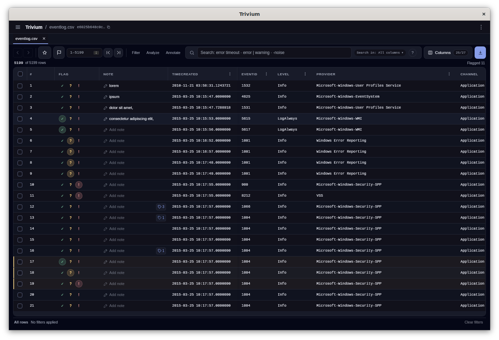
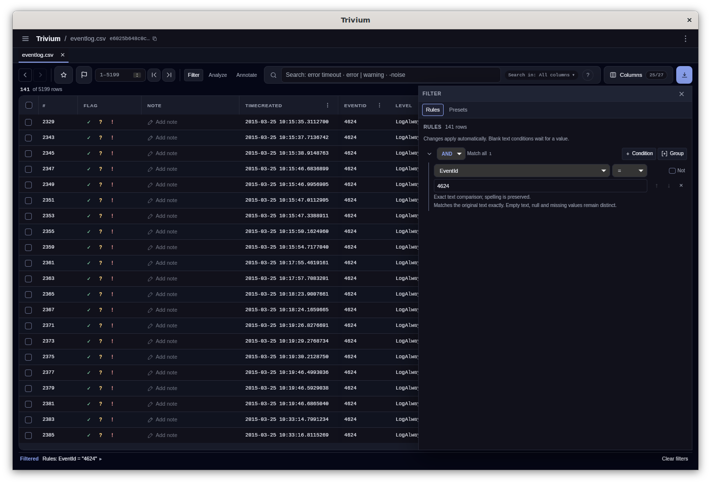
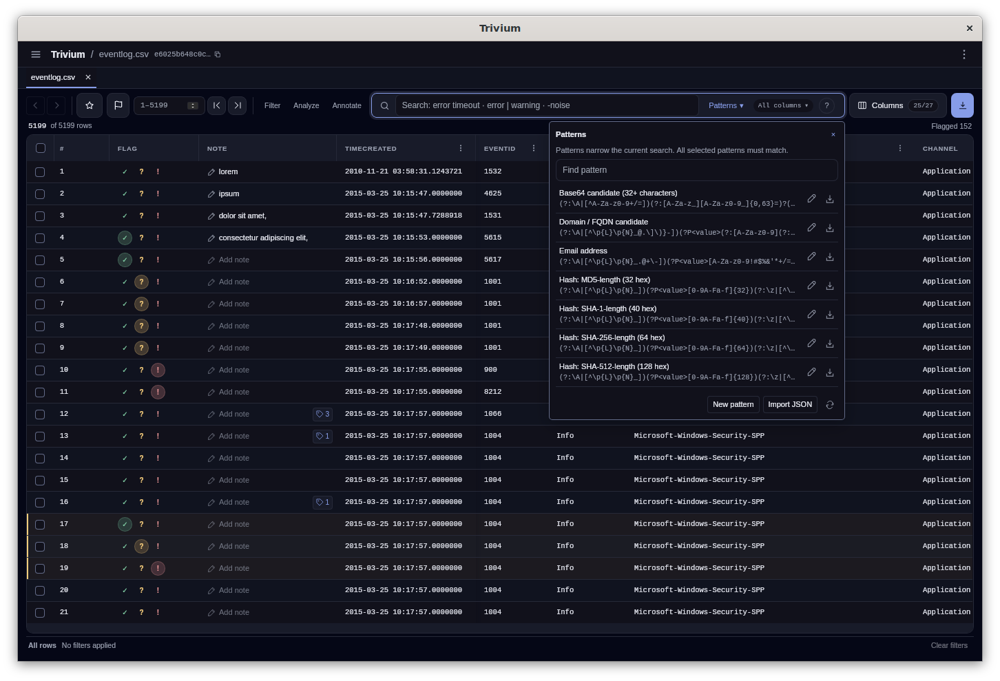
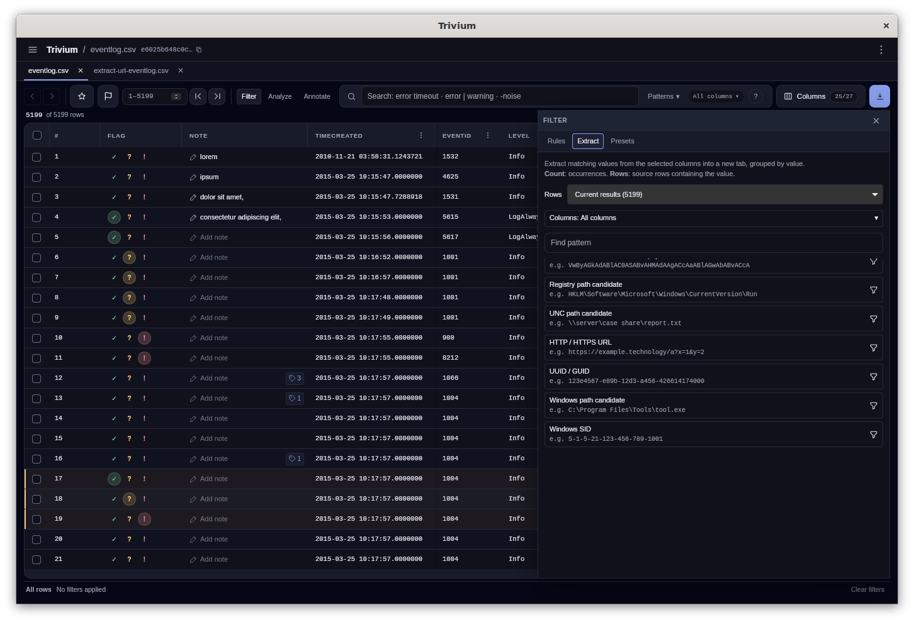
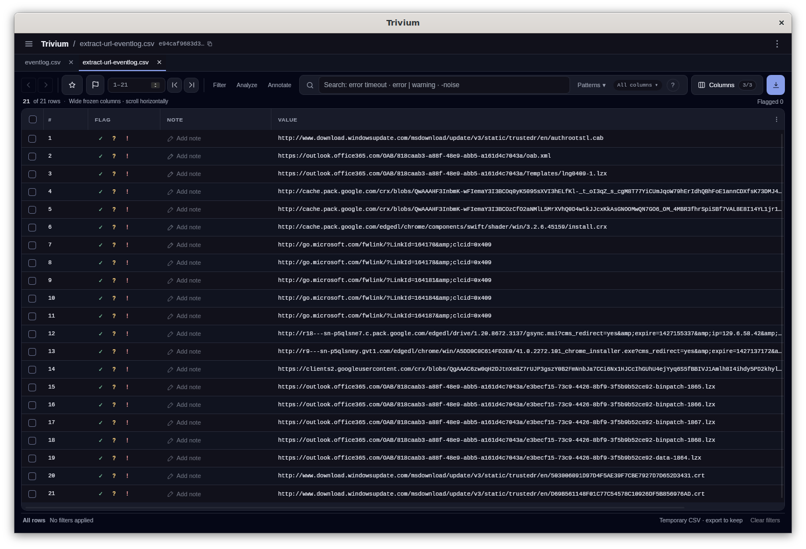
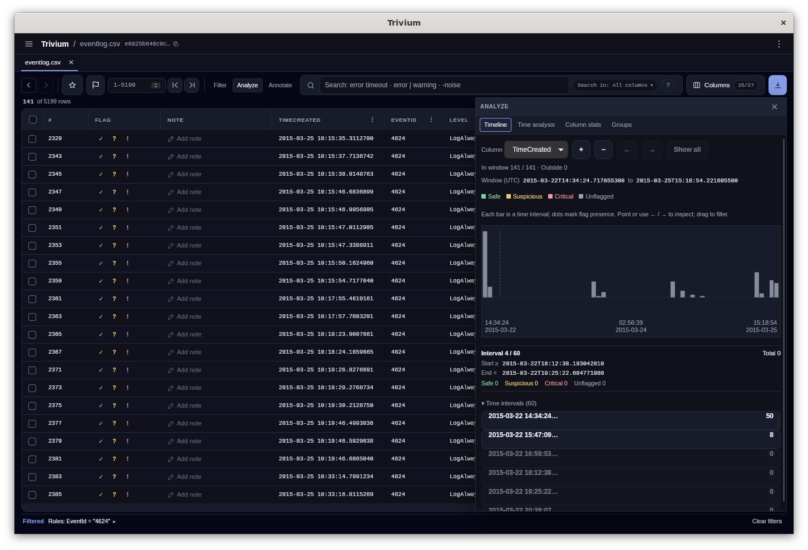
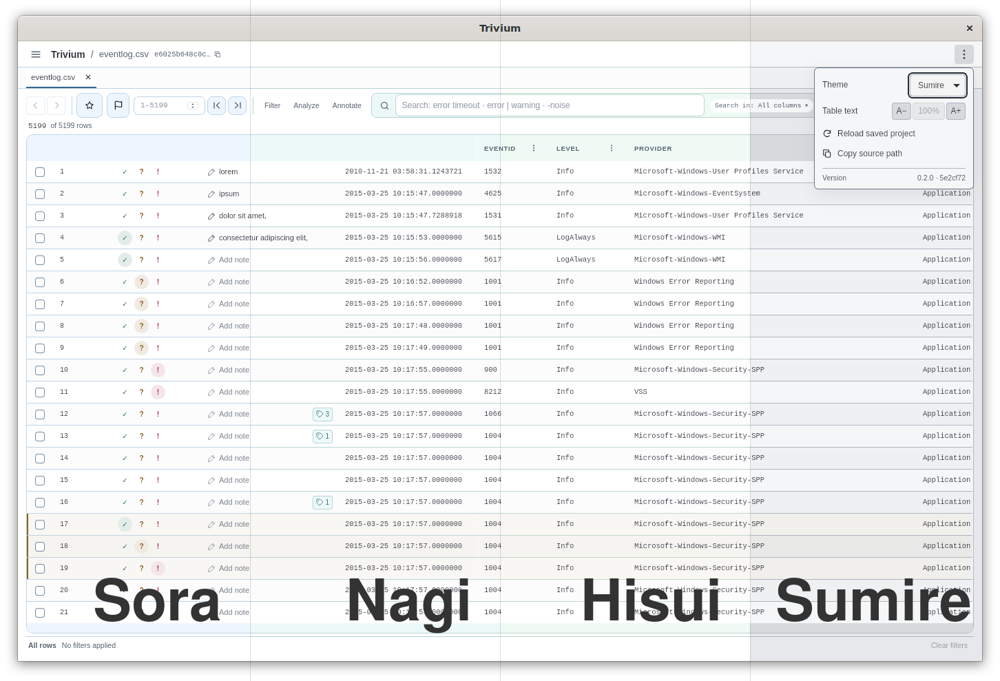
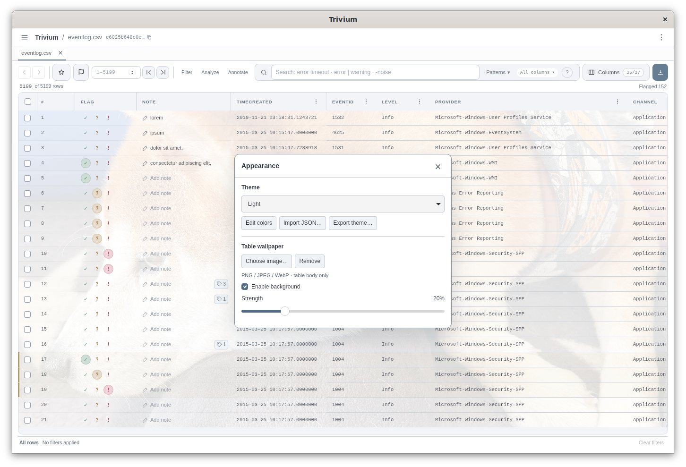

# Trivium

**"For the trivial bits of log analysis."**

[](LICENSE)


## Introduction

**Trivium** is a desktop application for exploring and investigating logs in CSV and JSON formats.

Designed for incident response, it brings together searching, filtering, flags, annotations, timeline analysis, IOC management, and other tools for working with log data.

Let's spend as little time as possible on the trivial stuff.



## Getting Started

1. [Download Trivium](#installation) for your platform.
2. Open or drop a CSV, JSON, JSONL, or NDJSON file into the window, then review the import settings.
3. Use the search box to narrow down rows, or open **Filter → Rules** to build more complex conditions.
4. Mark rows as **Safe**, **Suspicious**, or **Critical**, and add notes or tags as you investigate.
5. Export the rows you need to CSV. Your investigation is saved automatically, so you can reopen it later from **Projects**.

## Features

### Log Viewer

View CSV, JSON, JSONL, and NDJSON logs in a table, including nested JSON records. Click a cell to inspect the full record without scrolling through all its columns.

CSV and JSON imports support up to 4,096 data columns. CSV can also include one leading Trivium annotation block. Wider files are rejected without dropping columns.

Imports are strict by default. **Import options** lets you open CSV without a header row, select an encoding, or choose **Recover readable records**. Unicode BOMs are recognized automatically; BOM-less Windows-1252 and Shift JIS require a selection. Recovery retains extra CSV fields, fills missing trailing fields with null, and skips invalid CSV/JSONL records where boundaries are known. A broken JSON array stops at its unreadable remainder. The saved import report shows repair/skip counts and up to 30 issue locations and reasons; the original file and its SHA-256 remain unchanged.

**Preview** is off by default. Enable it to inspect a bounded sample before importing; suggested CSV delimiters are applied only when you choose them. Records are limited to 64MiB while reading, with cancellation checks; JSONL checks both encoded and decoded size. JSONL recovery can also skip invalid UTF-16, UTF-32, or Shift JIS lines without inserting replacement characters.

The import report records the delimiter, recovery mode, and annotation restoration setting. **Export JSONL** writes its summary and all recorded diagnostics; the screen still shows at most 30 examples.

Open multiple files in tabs, reorder and resize columns, hide columns you don't need, and pin important columns in place.

You can also drag and drop files into the window to review the import settings before opening them.

### Search & Filter

Search for keywords, restrict searches to selected columns, or build more complex conditions using AND, OR, and NOT. Use the back and forward buttons to revisit previous filter rules.

Save filter rules, column layouts, and sort order as presets for files with matching columns.



#### Search Syntax

Use the search box to narrow down results with case-insensitive text matching. It does not support parentheses or regular expressions directly. Choose **Patterns ▾** for regular expression patterns, or use **Filter → Rules** for grouped AND/OR conditions and numeric or datetime comparisons.

| Example | Description |
| --- | --- |
| `powershell` | Find rows containing the specified text |
| `error timeout` | Find rows containing both terms, possibly in different searched columns (AND) |
| `error\|warn` | Find rows containing either term (OR) |
| `-test` | Exclude rows containing `test` (NOT) |
| `EventID:4624` | Find rows containing `4624` in the `EventID` column |
| `"powershell -enc"` | Find the quoted phrase within a single cell |
| `-"powershell -enc"` | Exclude rows with the quoted phrase within a single cell |
| `@tag:review` | Find rows tagged with `review` |
| `@tag:*` | Find rows with any tag |

#### Search Patterns

Use **Patterns ▾** beside the search box to select built-in or saved regular expressions, or create your own. Text queries, selected patterns, and filter rules are combined with AND. The column selector applies to both text queries and patterns. Applied pattern definitions are saved with the investigation, so later edits do not silently change existing filters.

Built-in patterns cover IP addresses, CIDRs, URLs, email addresses, hashes, paths, Windows identifiers, defanged IOCs, and encoded or structured values. Hash patterns identify hexadecimal candidates of a given length; they do not determine the hashing algorithm. Structural checks do not verify signatures, ownership, or network reachability.

**IPv4-like** and **IPv6-like** patterns match complete address, CIDR, or endpoint tokens. For complete URLs, use the URL pattern; IP-like patterns do not extract an address from the middle of a URL that contains a path. Supported network patterns recognize defanged spellings and preserve the original text in extracted results. The Base64 pattern identifies candidates, so unrelated identifiers and hashes may also match its syntax.

Built-in pattern definitions live in `definitions/formats/`. Adding a valid JSON file registers it in the next build. Custom pattern JSON files can also be imported through the pattern picker.



### Extract

Open **Filter → Extract**, choose whether to scan all rows or the current results, select the source columns, and then pick a pattern. Trivium opens the extracted values in a temporary CSV tab with **Value**, **Count** (occurrences), and **Rows** (source rows containing the value). Three occurrences in a single row count as **Count: 3 / Rows: 1**. Hidden source columns can also be included.

JSON extraction counts primitive source values once across overlapping parent/child selections. Object keys are excluded.



Search, sort, and export extracted values using the same controls as any other CSV. Temporary result tabs do not appear in **Recent** and are deleted when closed, so export the results if you want to keep them. If exact aggregation reaches its memory limit, narrow the source rows or columns and try again.



### Flags & Annotations

Assign one of three flags to rows as you investigate:

- **Safe** — Rows you have determined to be harmless
- **Suspicious** — Rows that may need further investigation
- **Critical** — Rows you have identified as significant or problematic

You can also add notes, tags, and bookmarks to individual rows. Use **Annotate → Bulk annotate** to apply flags, notes, or tags to selected rows, the current results, or all rows. You can undo the most recent bulk operation.

Right-click a cell or use its record details to create an IOC rule from the exact value. Edit rules in **Annotate → IOC rules**; **Save rules** keeps their definitions, while **Apply** annotates matching rows across the project.


### Timeline & Analysis

For logs with a datetime column, the timeline shows when events occurred, including event counts broken down by Safe, Suspicious, Critical, and unflagged rows.

Datetime analysis accepts year-first dates with `-`, `/`, or `.`, unpadded components, comma or dot fractions, UTC/GMT and numeric offsets, and English month names with an explicit zone. Missing zones mean UTC. Nanoseconds and source text are preserved; ambiguous month/day ordering and numeric epochs are not guessed.

Zoom in on periods of high activity, or select a time range to narrow down the table. Value counts, rare values, time gaps, and grouping tools provide other ways to explore the data.



### Save & Export

Trivium automatically saves each investigation as a local project, including its filters and annotations. Closing a tab does not delete the project; reopen it from **Projects** to continue your investigation.

Export **all rows, the current results, or selected rows** to CSV, optionally including flags, notes, tags, and bookmarks.

CSV exports preserve source values. Spreadsheet software can interpret cells starting with `=`, `+`, `-`, or `@` as formulas; review untrusted exports in a text viewer.

The Save dialog asks for confirmation before replacing an existing file. Automation requests must set `allowOverwrite: true` to overwrite a file.

## Appearance

### Themes

Choose from a variety of color themes to suit your preferences.

Use **⋮ → Appearance → Edit colors** to enter hexadecimal colors, preview changes, and save a custom theme. You can also import and export themes as JSON.

Built-in theme definitions live in `definitions/themes/`. Adding a valid JSON file registers it in the next build.





### Wallpaper

Choose a local PNG, JPEG, or WebP image as the table wallpaper. It covers the table body, including fixed columns, and scales to fill the available area.



*And yes, that's my adorable dog in the screenshot.*

## Automation

The standalone `trivium-cli` executable provides an interface for scripts and LLM-assisted investigations. See the [Python example](examples/automate.py) to get started.

The example uses only the Python standard library. Run it from the repository root to import a log into a workspace and print matching rows:

```sh
python examples/automate.py --cli /path/to/trivium-cli --workspace ./investigation --source /path/to/events.csv --search powershell
```

## Installation

Prebuilt binaries are available for **Windows (x64)** and **Linux (x64)**:

- **Windows:** Portable `.exe` in a ZIP archive
- **Linux:** `.deb` package or AppImage in a ZIP archive

Download the latest version for your platform from [GitHub Releases](https://github.com/sumeshi/trivium/releases).

The Windows version requires [Microsoft Edge WebView2 Runtime](https://developer.microsoft.com/en-us/microsoft-edge/webview2/). Install it first if it is not already available.

## Feedback

Bug reports and feature requests are welcome in [GitHub Issues](https://github.com/sumeshi/trivium/issues).

## License

Trivium is released under the [MIT License](LICENSE).

### Third-party Licenses

Trivium includes third-party open-source software distributed under their respective licenses.

Copyright notices and license terms for third-party components are provided in `THIRD_PARTY_LICENSES.txt`, included with each binary distribution.

## Acknowledgments

Trivium was inspired by Eric Zimmerman's [Timeline Explorer](https://ericzimmerman.github.io/). Many thanks to him for his excellent work.
