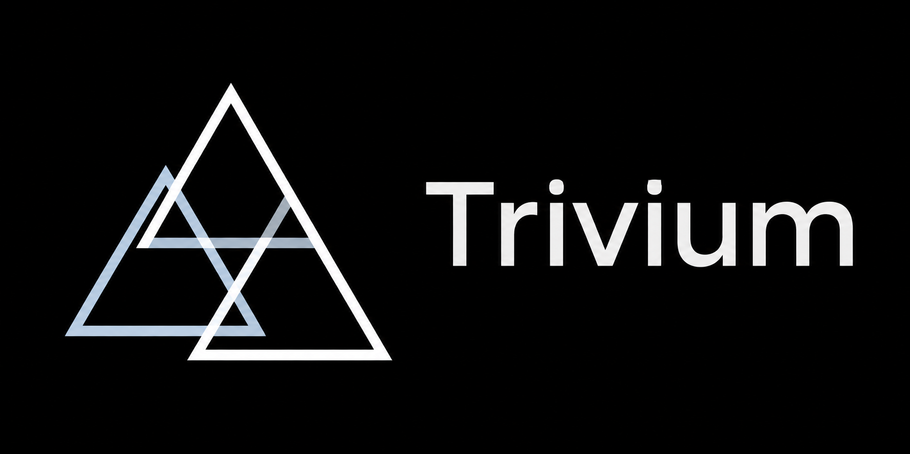

<h1 align="center"></h1>

Trivium is a desktop application for manually investigating CSV / JSON / JSONL / NDJSON data.
Search, narrow the table, inspect full values, and record your findings with **Safe / Suspicious / Critical**, notes, tags and bookmarks.


## Install

- **Windows:** download `Trivium-v*.exe` from [Releases](https://github.com/sumeshi/trivium/releases). The portable application requires Microsoft's [WebView2 Runtime](https://developer.microsoft.com/en-us/microsoft-edge/webview2/).
- **Linux:** download `trivium-deb` from a successful [Debian build](https://github.com/sumeshi/trivium/actions/workflows/debian.yml), extract it, then run `sudo apt install ./package.deb` with the actual filename. Development artifacts expire after three days.

The application's **Workspace options** menu shows its version and source commit. CI artifact ZIPs include `BUILD-INFO.json` and `SHA256SUMS` for the extracted package or executable; GitHub's artifact ZIP has a separate checksum. The hash beside an opened filename identifies the source data, not the application build.

## Investigate

1. Open **Projects**, choose a data file, and open it. CSV delimiter options apply only to CSV; the first record supplies column names. The source stays read-only.
2. Search or use **Filters** to narrow the result. Click a row value for its full record; right-click cells and column headings for contextual actions.
3. Record flags, notes, tags and bookmarks. These annotations are independent; unflagged rows are not Safe.
4. Export all rows, the current result, or selected rows to CSV. Optional `trivium-*` columns include annotations.

Open projects use tabs. Closing a tab preserves its saved case and annotations; reopen it from Projects. The `#` column and row-jump input refer to original, one-based row numbers even after filtering or sorting. First / Last move within the current result.

Column visibility and freezing affect presentation, not search scope. **Search in** chooses text-search columns. **Analysis** contains column statistics, nested grouping, time analysis and the timeline; **Annotations** contains bulk operations and IOC rules. Auxiliary panels calculate while open. Themes are available in Workspace options.

### Search

Text search is case-insensitive. Combine terms with spaces for AND, `|` for OR, and a leading `-` for NOT; NOT takes precedence over AND, then OR. Quote literal phrases and special characters. Scope a term with `column:value`.

| Example | Meaning |
| --- | --- |
| `error timeout` | Both terms |
| `error\|warn` | Either term |
| `beacon -test` | Include beacon, exclude test |
| `user:administrator` | Search one column |
| `command:"powershell -enc"` | A phrase in one column |

Use Filters for nested AND/OR groups, numeric or datetime comparisons, and regular expressions. Text search and structured conditions combine with AND. Text search itself does not interpret regex or parentheses.

## Saved data

The desktop workspace lives under:

- Linux: `$XDG_DATA_HOME/com.trivium.app/trivium`, or `~/.local/share/com.trivium.app/trivium`.
- Windows: `%LOCALAPPDATA%\com.trivium.app\trivium`.

Each `projects/<uuid>/` contains `data.parquet` and `project.sqlite`: imported evidence plus annotations, view settings and durable bulk undo. Stop Trivium and any automation before backing up the whole workspace. Deleting a saved case removes its imported copy, leaving the original source untouched.

CSV values retain their original text. JSON objects and arrays of objects become rows; nested keys use JSON Pointers. Empty strings, null and missing values stay distinct. Large integers and nanosecond timestamps retain their original precision.

## Automation

`trivium-cli` is a separate, optional Rust program for Python or other scripts. The desktop application does not launch or require it. It uses the same engine and saved-case format, receiving JSON-line requests on stdin and returning responses on stdout; no server or embedded Python is involved.

```sh
cargo build --locked --release -p trivium-engine --bin trivium-cli
python examples/automate.py --cli target/release/trivium-cli --workspace /cases/demo --source /evidence/events.csv --search "needle"
```

On Windows, use `target\release\trivium-cli.exe`. The [Python example](examples/automate.py) provides `Trivium.call(method, params)`. Send `{"version":1,"method":"hello"}` to list methods. Requests are sequential; inspect each response's `ok` and `result` or `error`. `query` is paged; `cell` returns a full value, and `export` writes a file. Row indices in this protocol are zero-based.

## Develop

The application uses Tauri 2, Svelte / TypeScript and a shared Rust engine. Polars queries Parquet evidence; SQLite stores case state. Install the Node and Rust versions pinned in [.node-version](.node-version) and [rust-toolchain.toml](rust-toolchain.toml), plus the [Tauri prerequisites](https://tauri.app/start/prerequisites/).

```sh
npm ci
npm run tauri dev
```

`npm run dev` starts the frontend only. Build a native package for your platform:

```sh
# Linux .deb
npm run tauri build -- --bundles deb
# Windows installer; the portable executable is also in target/release/
npm run tauri build -- --bundles nsis
```

Use a release build when comparing responsiveness. Engine timings exclude IPC, state updates and WebView rendering.

Checks:

```sh
cargo test --locked -p trivium-engine
cargo clippy --locked -p trivium-engine --all-targets -- -D warnings
bash scripts/check_rust_size.sh
npm run lint
npm run lint:test
npm run test:ui
npm run contracts:check
npm run build
```

Native GUI checks use the actual embedded application and isolated case profiles; their setup is in [Native smoke](.github/workflows/native-smoke.yml). On Linux, with GTK / WebKitGTK, Xvfb, `libxtst6`, `tauri-driver` and `WebKitWebDriver` installed:

```sh
cargo build --locked -p trivium-desktop --features custom-protocol
xvfb-run -a python3 tests/native/row_navigation.py --binary target/debug/trivium-desktop --rows 5199 2000000
xvfb-run -a python3 tests/native/workspace_ui.py --binary target/debug/trivium-desktop
```

For rendering and IPC measurements with synthetic small, tall and wide datasets:

```sh
xvfb-run -a python3 tests/native/render_benchmark.py --binary target/release/trivium-desktop --out target/render-performance
```

`scripts/gen_fixture.py` generates deterministic CSV test data. Engine benchmarks live in `crates/engine/src/bin/`; generated datasets and measurements belong outside the source tree or under ignored `target/` paths. Update Rust wire DTOs with `npm run contracts:generate`.

[MIT License](LICENSE)
